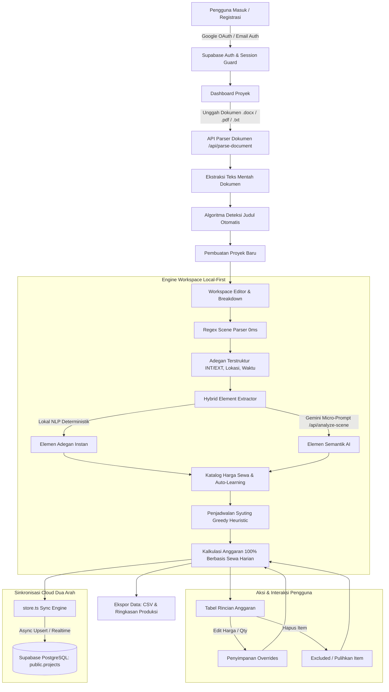

# Dokumentasi Arsitektur Sistem, Alur Kerja, dan Teknologi
## Proyek: ScriptFlow AI (Sistem Manajemen Skenario & Estimasi Anggaran Produksi Film)

---

## 1. Ringkasan Eksekutif (Executive Summary)

**ScriptFlow AI** adalah platform cerdas manajemen pra-produksi perfilman yang dirancang untuk mentransformasikan proses tradisional *script breakdown*, penjadwalan syuting, dan estimasi anggaran produksi yang biasanya memakan waktu berhari-hari menjadi proses otomatis dalam hitungan detik.

Dengan pendekatan **Hybrid Local-First AI**, ScriptFlow AI membaca naskah skenario (format Word `.docx`, PDF `.pdf`, Fountain, atau teks polos), mengidentifikasi judul dan memecah adegan secara instan, mengekstrak kebutuhan logistik (pemeran, properti, kostum, lokasi, pencahayaan, audio, dan tata rias), menyusun jadwal syuting cerdas, serta menghitung total **anggaran sewa harian (rental & jasa logistik)** secara dinamis dengan sinkronisasi ke cloud database Supabase.

---

## 2. Diagram Alur Sistem (High-Level System Flow)



---

## 3. Penjelasan Lengkap Seluruh Alur Sistem (End-to-End Workflow)

### Tahap 1: Autentikasi Pengguna & Keamanan Sesi (Auth Guard)
1. **Pintu Masuk (`/login` & `/register`)**: Pengguna dapat masuk menggunakan **Google OAuth** satu klik atau kombinasi **Email dan Password**.
2. **Koneksi Supabase Auth**: Kredensial diproses oleh engine otentikasi Supabase. Token JWT dan sesi browser disimpan secara aman melalui cookies HTTP-Only dan SSR client (`@supabase/ssr`).
3. **Auth Callback (`/auth/callback`)**: Token pertukaran OAuth divalidasi di server, membuat entitas profil pengguna di database, dan langsung mengarahkan pengguna ke Dashboard utama.
4. **Proteksi Route**: Root (`/`) memiliki guard otomatis: jika belum login, pengguna diarahkan ke `/login`; jika sudah login, langsung diarahkan ke `/dashboard`.

---

### Tahap 2: Ingesti Berkas Naskah Multi-Format
Pengguna dapat memasukkan naskah melalui dua titik masuk:
- **Dialog Proyek Baru di Dashboard**
- **Editor Naskah di Workspace** (`+ Unggah file (.docx, .pdf, .txt)` atau *Drag-and-Drop* langsung ke kanvas)

Alur pemrosesan dokumen:
1. File dikirim ke Route Handler server `POST /api/parse-document`.
2. Jika berkas berupa **Microsoft Word (`.docx`)**: Diekstrak menggunakan `mammoth.js` untuk mengambil struktur teks bersih tanpa *formatting artifacts*.
3. Jika berkas berupa **Adobe PDF (`.pdf`)**: Diekstrak teks halamannya menggunakan parser PDF berkinerja tinggi.
4. Jika berkas berupa **Teks Polos / Markdown / Fountain (`.txt`, `.fountain`, `.md`)**: Dibaca seketika di peramban menggunakan browser `FileReader API`.

---

### Tahap 3: Deteksi Judul Naskah Otomatis (`detectTitleFromScript`)
Sistem tidak lagi mengharuskan pengguna mengetik judul secara manual. Algoritma cerdas mendeteksi judul skrip asli dengan hierarki prioritas:
1. **Pola Eksplisit Standar**: Memeriksa tag metadata skenario baku seperti `Title: ...`, `Judul: ...`, atau `Judul Naskah: ...`.
2. **Header Markdown**: Memeriksa tag `# Judul`.
3. **Penyaringan Halaman Judul & Slugline**:
   - Menyaring dan membuang penomoran halaman atau nomor adegan (seperti baris tunggal `1.`, `(1)`, atau angka romawi).
   - Mengabaikan baris kredit (seperti `Ditulis oleh`, `Draft 1`, `Penulis: ...`).
   - Berhenti saat menemui slugline adegan pertama (`INT.` atau `EXT.`).
   - Membersihkan nomor urut jika judul diawali angka (misal `1. THE LAST NET` $\rightarrow$ `THE LAST NET`).
4. **Fallback Nama File**: Jika teks tidak memuat judul tertulis, sistem mengambil nama berkas file yang telah dibersihkan dari simbol `_`, `-`, dan ekstensi file.
5. **Auto-Repair di Workspace**: Jika proyek yang sedang aktif masih memiliki judul berupa angka atau placeholder, sistem secara otomatis menggantinya dengan judul asli naskah.

---

### Tahap 4: Pemecahan Adegan Lokal-First (0 ms Scene Parsing)
1. Teks naskah di-scan menggunakan **Regex Slugline Parser** standar industri perfilman:
   - Pola: `^(INT|EXT|INT/EXT|I/E)\.?\s+(.+?)\s*-\s*(PAGI|SIANG|SORE|MALAM|SUBUH|SENJA|DINI HARI)`
2. Setiap adegan dipecah menjadi objek terstruktur: nomor adegan, tipe lokasi (*Interior/Exterior*), nama lokasi, waktu (*Day/Night*), teks tubuh adegan, serta tanda pengenal unik (*content hash*).
3. Proses ini berjalan dengan **latensi 0 milidetik** tanpa memerlukan koneksi jaringan atau kuota token AI.

---

### Tahap 5: Ekstraksi Kebutuhan Elemen Produksi (Hybrid Semantics)
ScriptFlow AI menggunakan strategi ekstraksi hibrida:
1. **Mesin Lokal Deterministik (0 Token, Instan)**:
   - Langsung mendeteksi karakter tokoh dari baris dialog kapital (misal `RIANA`, `KAKEK WIRYO`).
   - Mengelompokkan kata kunci properti, kendaraan, dan pencahayaan dasar dari aksi deskriptif.
2. **Pengayaan Semantik Gemini AI (Micro-Prompting)**:
   - Setiap adegan yang baru atau diedit dikirim ke endpoint `/api/analyze-scene` secara modular per-adegan (*chunked*).
   - Prompt instruksional fokus hanya pada adegan terkait untuk mengidentifikasi detail:
     - Kebutuhan aktor/pemeran (utama, pendukung, figuran).
     - Properti spesifik dan set dressing.
     - Kostum & tata rias khusus (misal pakaian dinas, luka memar).
     - Peralatan teknis (kamera, tata cahaya malam, boom mic).
   - Hasil di-*cache* secara progresif berdasarkan *content hash* adegan, sehingga pengetikan ulang pada adegan lain tidak memboroskan analisis adegan yang tidak berubah.

---

### Tahap 6: Perencanaan Jadwal Syuting Cerdas (Production Scheduling)
1. Dijalankan dengan algoritma **Greedy Grouping Heuristic**:
   - Mengelompokkan adegan berdasarkan kesamaan lokasi untuk meminimalkan mobilitas kru dan perpindahan alat berat.
   - Mengurutkan adegan dalam lokasi yang sama berdasarkan urutan waktu (*Subuh $\rightarrow$ Pagi $\rightarrow$ Siang $\rightarrow$ Sore $\rightarrow$ Malam*) guna efisiensi setup pencahayaan (*lighting turnaround*).
2. Menghasilkan ringkasan hari syuting (*Shooting Days*), adegan per hari, dan durasi total hari produksi.

---

### Tahap 7: Kalkulasi Anggaran 100% Berbasis Sewa Harian (Rental-First Logistics)
1. **Model Anggaran Sewa (Rental & Opex)**:
   - Seluruh elemen logistik dihitung berbasis tarif sewa harian yang dikalikan dengan jumlah hari syuting adegan tempat elemen tersebut digunakan.
   - Contoh: Karakter aktor yang hanya muncul di 1 hari syuting hanya dibebankan biaya jasa sewa pemeran selama 1 hari.
2. **Katalog Master & AI Auto-Learning**:
   - Jika item cocok dengan database harga (katalog standar persewaan alat/jasa film Indonesia), tarif sewa diterapkan otomatis.
   - Jika item belum pernah tercatat, sistem AI mengestimasi tarif sewa wajar di pasar Indonesia dan menyimpannya ke memori katalog (*auto-learned*).
3. **Kontingensi Dinamis**: Pengguna dapat mengatur margin risiko kontingensi (0%, 5%, 10%, 15%, 20%) yang otomatis mengkalkulasi total anggaran produksi.

---

### Tahap 8: Aksi Interaktif Entitas Anggaran (Edit, Hapus, Pulihkan)
Pengguna memiliki kontrol penuh terhadap setiap baris item di tabel anggaran:
1. **Aksi Edit (Ubah)**:
   - Membuka modal interaktif untuk mengubah **Tarif Sewa Harian (Rp)** dan **Kuantitas (Qty)**.
   - Menyediakan kalkulasi langsung: `Qty × Harga Sewa × Hari Syuting = Subtotal Baru`.
   - Opsi *Reset Standar* untuk mengembalikan ke harga katalog awal.
2. **Aksi Hapus**:
   - Mengeluarkan item yang tidak ingin disewa (misalnya properti gratis dari pemilik lokasi).
   - Memberikan rincian langsung pengurangan total anggaran.
3. **Aksi Pulihkan (Restore)**:
   - Item yang dihapus tidak dimusnahkan secara permanen, melainkan dicatat di section *"Item Dihapus dari Anggaran"*.
   - Dapat dipulihkan kembali kapan saja dengan satu klik.

---

### Tahap 9: Sinkronisasi Cloud Dua Arah (Supabase PostgreSQL Sync)
1. **Penyimpanan Hibrida di `store.ts`**:
   - **Optimistic UI (0 ms)**: Operasi buat proyek, ketik naskah, ubah harga, dan hapus item langsung diperbarui di memori dan `localStorage` secara instan tanpa menunggu respons jaringan.
   - **Cloud Sync**: Jika pengguna login ke Supabase, mutasi data secara asinkron di-`upsert` ke tabel PostgreSQL `public.projects`.
2. **Realtime Listener**:
   - Berlangganan kanal `postgres_changes` Supabase. Jika proyek diubah dari perangkat atau tab lain, dashboard langsung ter-update secara otomatis.

---

### Tahap 10: Ekspor Laporan Produksi
- Tombol **Ekspor CSV** di header workspace mengekspor seluruh rincian anggaran, kategori, kuantitas, harga sewa per hari, jumlah hari syuting, dan subtotal ke dalam format file spreadsheet (`.csv`) yang kompatibel dengan Microsoft Excel dan Google Sheets.

---

## 4. Teknologi yang Digunakan & Alasan Pemilihannya

| Layer / Komponen | Teknologi yang Dipilih | Alternatif yang Dipertimbangkan | Alasan Pemilihan & Keunggulan Arsitektur |
| :--- | :--- | :--- | :--- |
| **Frontend Framework** | **Next.js (App Router, React 19)** | Vite + React SPA, Create-React-App | • Mendukung **Server Components (RSC)** dan **Route Handlers** dalam satu codebase.<br>• Optimasi SSR dan hidrasi instan.<br>• Arsitektur App Router memungkinkan penanganan sesi auth berbasis cookie yang aman di tingkat middleware/route. |
| **Bahasa Pemrograman** | **TypeScript** | JavaScript biasa | • **Keamanan Tipe Ketat (Type Safety)** untuk struktur naskah yang kompleks (adegan, elemen, harga, kategori).<br>• Mencegah bug kalkulasi keuangan/anggaran di masa pengembangan.<br>• *Autocomplete* dan refactoring yang andal untuk proyek berskala hackathon/produksi. |
| **Styling & UI Design** | **Tailwind CSS (Vanilla Custom CSS Tokens)** | Bootstrap, Material UI, Chakra UI | • **Zero Runtime CSS Overhead**: Performa render dokumen panjang ribuan kata tetap ringan.<br>• Fleksibilitas penuh merancang antarmuka **Dark Mode Sinematik** dengan aksen amber/gold khas industri perfilman.<br>• Animasi mikro responsif (*glow*, *pop*, *fade*) yang membuat UI terasa premium. |
| **Database & Backend Cloud** | **Supabase (PostgreSQL 15)** | Firebase Firestore, MongoDB, MySQL | • **PostgreSQL Relasional**: Hubungan antar tabel (`profiles` $\rightarrow$ `projects` $\rightarrow$ `scenes`) memiliki integritas referensial dan skema kuat.<br>• **Row Level Security (RLS)** bawaan: Data proyek hanya bisa diakses dan diedit oleh pemilik sah akun di level basis data.<br>• **Kolom JSONB**: Fleksibel menyimpan *price overrides* dinamis tanpa harus mengubah skema relasional tabel. |
| **Autentikasi Pengguna** | **Supabase Auth (GoTrue & Google OAuth)** | NextAuth.js, Firebase Auth, Custom JWT | • Integrasi langsung dengan Postgres RLS (`auth.uid() = owner_id`).<br>• Dukungan Google OAuth bawaan tanpa memerlukan server backend tambahan.<br>• Manajemen sesi JWT dan refresh token otomatis. |
| **AI & NLP Engine** | **Google Gemini API (Flash/Pro)** | OpenAI GPT-4o, Anthropic Claude | • **Jendela Konteks Sangat Cepat & Efisien**: Kecepatan inferensi Gemini Flash ideal untuk analisis skenario per-adegan secara interaktif.<br>• **Arsitektur Micro-Prompting**: Skrip tidak dikirim utuh ribuan baris, melainkan dipotong per adegan sehingga menghemat token hingga 90% dan menurunkan latensi secara drastis.<br>• Kemampuan pemahaman bahasa Indonesia kontekstual yang sangat akurat untuk istilah skenario lokal. |
| **Parsing Dokumen** | **Mammoth.js & pdf-parse** | Python Tesseract OCR, Pandoc | • Murni berjalan di runtime Node.js tanpa membutuhkan instalasi dependensi biner pihak ketiga di sistem operasi host.<br>• Ekstraksi teks naskah Word (.docx) dan PDF mempertahankan integritas baris percakapan dan slugline adegan. |
| **Pola Arsitektur Data** | **Hybrid Local-First + Cloud Sync** | 100% Server-side API Crud | • **0 ms Input Lag**: Penulis naskah yang mengetik di editor tidak pernah mengalami penundaan/spinner loading karena data langsung tersimpan lokal secara deterministik.<br>• **Ketahanan Offline**: Aplikasi tetap berfungsi optimal meskipun jaringan internet lambat atau terputus.<br>• Sinkronisasi otomatis ke cloud di latar belakang (*background sync*). |

---

## 5. Skema Basis Data Supabase (Database Schema)

Skrip SQL lengkap terdapat pada berkas `supabase/migrations/001_auth_and_schema.sql`.

### Struktur Entitas Utama:
1. **`public.profiles`**:
   - `id` (UUID, Primary Key $\rightarrow$ `auth.users.id` on delete cascade)
   - `email` (Text)
   - `name` (Text)
   - `avatar_url` (Text)
   - `role` (Text, default 'Line Producer')
   - `provider` (Text: 'google' / 'email')
   - *Trigger otomatis*: Salin data profil saat pendaftaran akun baru di Supabase Auth.

2. **`public.projects`**:
   - `id` (UUID, Primary Key default `uuid_generate_v4()`)
   - `owner_id` (UUID $\rightarrow$ `auth.users.id` on delete cascade)
   - `title` (Text)
   - `format` (Text: 'film_pendek', 'teater', 'serial_web', 'konten')
   - `script_text` (Text, naskah skenario lengkap)
   - `contingency_pct` (Numeric, persentase kontingensi risiko)
   - `overrides` (JSONB, menyimpan penyesuaian harga manual, edit qty `__qty`, dan status hapus `__deleted`)
   - `created_at` / `updated_at` (Timestamptz)

3. **Row Level Security (RLS)**:
   - Kebijakan isolasi data ketat:
     ```sql
     create policy "Pengguna hanya dapat mengelola proyek miliknya"
       on public.projects for all
       using (owner_id = auth.uid())
       with check (owner_id = auth.uid());
     ```

---

## 6. Nilai Tambah Kompetitif (Competitive Advantages)

1. **Zero-Friction Ingestion**: Pengguna cukup mengunggah satu berkas naskah Word atau PDF. Judul dibaca otomatis, adegan dipecah otomatis, dan anggaran langsung tersusun tanpa perlu konfigurasi manual.
2. **Realisme Bisnis Produksi Film Indonesia**: Menggunakan model **100% Rental / Jasa Harian** yang mencerminkan praktik riil produser film Indonesia (pemeran harian, sewa set harian, sewa kamera & lighting per shift syuting).
3. **Fleksibilitas Penuh Produser**: Tersedianya aksi **Edit** harga & kuantitas serta **Hapus & Pulihkan** item memberikan kendali penuh kepada *Line Producer* untuk menyesuaikan anggaran di lapangan.
4. **Keamanan & Skalabilitas Cloud**: Terhubung ke PostgreSQL Supabase dengan proteksi keamanan level enterprise (Google OAuth & RLS).
