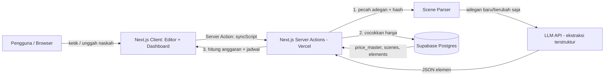

# ScriptFlow AI — Blueprint Lengkap Pembangunan Website

> Sistem otomatisasi *script breakdown* dan estimasi anggaran produksi real-time berbasis Generative NLP. Dokumen ini adalah versi lengkap dari form pendaftaran PENS Hackathon 2026 (Choice 2) menjadi rencana teknis yang bisa langsung dikerjakan.

---

## 1. Ringkasan Produk

| Item | Isi |
| --- | --- |
| Nama | ScriptFlow AI |
| Pengguna | Penulis naskah, produser, line producer, kreator konten, grup teater |
| Masalah | Breakdown naskah & hitung anggaran manual, lama, rawan salah, dan harus diulang saat naskah direvisi |
| Solusi | Unggah/tulis naskah → AI ekstrak elemen per adegan → harga otomatis dari master data → anggaran & jadwal ter-update real-time saat naskah direvisi |
| Stack | Next.js 15 (App Router + Server Actions), Supabase (Postgres, Auth, Storage), LLM API, Vercel |

### Alur utama pengguna

1. Login → buat proyek (pilih format: film pendek / teater / serial web / konten).
2. Tempel teks naskah atau unggah file `.docx` / `.pdf` / `.txt`.
3. Sistem memecah naskah menjadi adegan, AI mengekstrak aktor, properti, kostum, lokasi, waktu, pencahayaan.
4. Sistem mencocokkan tiap elemen dengan `price_master` dan menghitung anggaran.
5. Pengguna merevisi naskah di editor → hanya adegan yang berubah diproses ulang → anggaran & jadwal ter-update tanpa reload.
6. Ekspor ke Excel / PDF.

---

## 2. Scope MVP (prioritas hackathon)

**Wajib (Must-have)**

- Auth (email magic link atau Google)
- CRUD proyek
- Editor naskah + parser adegan
- AI breakdown per adegan (NER via LLM dengan structured output)
- Master harga (seed data) + pencocokan otomatis
- Tabel breakdown + panel anggaran total
- Revisi real-time (incremental re-analysis berbasis hash adegan)

**Sebaiknya ada (Should-have)**

- Jadwal syuting otomatis (pengelompokan per lokasi & waktu)
- Ekspor Excel
- Edit manual harga & elemen (override hasil AI)

**Jika sempat (Nice-to-have)**

- Ekspor PDF, riwayat versi anggaran, kolaborasi multi-user, import `.docx`/`.pdf`

---

## 3. Tech Stack

| Lapisan | Teknologi | Alasan |
| --- | --- | --- |
| Framework | Next.js 15 (App Router, React 19) | Server Actions untuk revisi tanpa reload |
| Bahasa | TypeScript | Aman tipe untuk skema hasil AI |
| UI | Tailwind CSS + shadcn/ui | Cepat dibangun, konsisten |
| Database & Auth | Supabase (Postgres + Auth + RLS) | Serverless, gratis untuk MVP |
| AI | Anthropic API (`@anthropic-ai/sdk`) dengan tool use | Output JSON terstruktur; bisa diganti model lain |
| Validasi | Zod | Memvalidasi respons AI |
| Ekspor | `exceljs` | Ekspor anggaran ke `.xlsx` |
| Parsing file | `mammoth` (docx), `pdf-parse` (pdf) | Unggah naskah |
| Deploy | Vercel | Serverless, CI otomatis dari GitHub |

> **Catatan istilah:** "NER" pada form dipenuhi dengan LLM yang mengekstrak entitas ber-skema (aktor, properti, kostum, dst.). Ini lebih praktis untuk bahasa Indonesia dibanding melatih model NER sendiri dan dapat dijelaskan jujur ke juri sebagai *LLM-based NER*.

---

## 4. Arsitektur Sistem



**Prinsip kunci: incremental re-analysis.** Setiap adegan disimpan dengan `content_hash` (SHA-256). Saat naskah direvisi, hanya adegan dengan hash baru yang dikirim ke AI. Inilah yang membuat revisi terasa real-time dan menghemat biaya API.

---

## 5. Struktur Folder

```
scriptflow-ai/
├─ app/
│  ├─ (auth)/login/page.tsx
│  ├─ (app)/
│  │  ├─ dashboard/page.tsx
│  │  └─ projects/[id]/
│  │     ├─ page.tsx                # workspace: editor + breakdown + budget
│  │     └─ actions.ts              # Server Actions
│  ├─ auth/callback/route.ts
│  ├─ layout.tsx
│  └─ globals.css
├─ components/
│  ├─ script-editor.tsx
│  ├─ breakdown-table.tsx
│  ├─ budget-panel.tsx
│  ├─ schedule-board.tsx
│  └─ ui/                           # shadcn
├─ lib/
│  ├─ supabase/{client.ts,server.ts}
│  ├─ ai/{extract.ts,schema.ts,prompts.ts}
│  ├─ script/{parse-scenes.ts,hash.ts}
│  ├─ budget/{calculate.ts,match-price.ts}
│  ├─ schedule/plan.ts
│  └─ export/excel.ts
├─ supabase/
│  ├─ migrations/001_init.sql
│  └─ seed.sql
├─ middleware.ts
├─ .env.local
└─ package.json
```

---

## 6. Setup Awal

```bash
npx create-next-app@latest scriptflow-ai --typescript --tailwind --app --eslint
cd scriptflow-ai

npm i @supabase/supabase-js @supabase/ssr @anthropic-ai/sdk zod exceljs mammoth pdf-parse
npx shadcn@latest init
npx shadcn@latest add button card input table tabs badge textarea dialog sonner
```

**`.env.local`**

```bash
NEXT_PUBLIC_SUPABASE_URL=https://xxxx.supabase.co
NEXT_PUBLIC_SUPABASE_ANON_KEY=xxxx
SUPABASE_SERVICE_ROLE_KEY=xxxx        # hanya server, jangan diberi prefix NEXT_PUBLIC
ANTHROPIC_API_KEY=xxxx
ANTHROPIC_MODEL=claude-sonnet-5-5     # ganti sesuai kebutuhan / budget
```

---

## 7. Database (Supabase)

### 7.1 Skema — `supabase/migrations/001_init.sql`

```sql
create extension if not exists pg_trgm;
create extension if not exists "uuid-ossp";

-- Proyek
create table projects (
  id uuid primary key default uuid_generate_v4(),
  owner_id uuid not null references auth.users(id) on delete cascade,
  title text not null,
  format text not null check (format in ('film_pendek','teater','serial_web','konten')),
  script_text text not null default '',
  contingency_pct numeric not null default 10,
  created_at timestamptz not null default now(),
  updated_at timestamptz not null default now()
);

-- Adegan
create table scenes (
  id uuid primary key default uuid_generate_v4(),
  project_id uuid not null references projects(id) on delete cascade,
  scene_no int not null,
  heading text not null,
  int_ext text,                     -- INT / EXT
  location text,
  time_of_day text,                 -- PAGI/SIANG/SORE/MALAM
  body text not null,
  content_hash text not null,
  analyzed_at timestamptz,
  unique (project_id, scene_no)
);

-- Elemen hasil breakdown
create type element_category as enum
  ('cast','prop','costume','location','lighting','sound','makeup','other');

create table scene_elements (
  id uuid primary key default uuid_generate_v4(),
  scene_id uuid not null references scenes(id) on delete cascade,
  category element_category not null,
  name text not null,
  quantity int not null default 1,
  notes text,
  price_item_id uuid,               -- hasil pencocokan ke price_master
  unit_price_override numeric,      -- override manual oleh pengguna
  created_at timestamptz not null default now()
);

-- Master harga lokal
create table price_master (
  id uuid primary key default uuid_generate_v4(),
  category element_category not null,
  name text not null,
  unit text not null,               -- hari / jam / unit / paket
  unit_price numeric not null,      -- Rupiah
  region text not null default 'Surabaya',
  keywords text[] not null default '{}'
);
create index price_master_name_trgm on price_master using gin (name gin_trgm_ops);

-- Jadwal syuting
create table shooting_days (
  id uuid primary key default uuid_generate_v4(),
  project_id uuid not null references projects(id) on delete cascade,
  day_no int not null,
  location text,
  scene_ids uuid[] not null default '{}',
  unique (project_id, day_no)
);

-- Fungsi pencocokan harga (fuzzy)
create or replace function match_price(q text, cat element_category)
returns table (id uuid, name text, unit text, unit_price numeric, score real)
language sql stable as $$
  select p.id, p.name, p.unit, p.unit_price,
         greatest(similarity(p.name, q),
                  coalesce((select max(similarity(k, q)) from unnest(p.keywords) k), 0)) as score
  from price_master p
  where p.category = cat
  order by score desc
  limit 1;
$$;

-- Row Level Security
alter table projects        enable row level security;
alter table scenes          enable row level security;
alter table scene_elements  enable row level security;
alter table shooting_days   enable row level security;
alter table price_master    enable row level security;

create policy "own projects" on projects
  for all using (owner_id = auth.uid()) with check (owner_id = auth.uid());

create policy "own scenes" on scenes
  for all using (exists (select 1 from projects p where p.id = project_id and p.owner_id = auth.uid()));

create policy "own elements" on scene_elements
  for all using (exists (
    select 1 from scenes s join projects p on p.id = s.project_id
    where s.id = scene_id and p.owner_id = auth.uid()));

create policy "own days" on shooting_days
  for all using (exists (select 1 from projects p where p.id = project_id and p.owner_id = auth.uid()));

create policy "read prices" on price_master for select using (auth.role() = 'authenticated');
```

### 7.2 Seed master harga — `supabase/seed.sql`

> Angka di bawah hanyalah **contoh placeholder**. Ganti dengan harga riil hasil survei vendor lokal (rental alat, kru, konsumsi, perizinan) sebelum demo.

```sql
insert into price_master (category, name, unit, unit_price, keywords) values
('cast',     'Pemeran utama',            'hari', 1500000, '{"aktor utama","lead","tokoh utama"}'),
('cast',     'Pemeran pendukung',        'hari',  750000, '{"pemeran pembantu","supporting"}'),
('cast',     'Figuran',                  'hari',  150000, '{"extras","pemeran tambahan"}'),
('prop',     'Sepeda motor (sewa)',      'hari',  200000, '{"motor","sepeda motor"}'),
('prop',     'Mobil (sewa + sopir)',     'hari',  600000, '{"mobil","kendaraan"}'),
('prop',     'Properti meja & kursi',    'hari',  100000, '{"meja","kursi","furnitur"}'),
('prop',     'Properti telepon',         'hari',   30000, '{"ponsel","handphone","hp"}'),
('costume',  'Kostum modern harian',     'set',    75000, '{"baju harian","pakaian"}'),
('costume',  'Kostum seragam',           'set',   100000, '{"seragam"}'),
('location', 'Sewa rumah / interior',    'hari',  500000, '{"rumah","ruang tamu","kamar"}'),
('location', 'Izin lokasi publik',       'hari',  250000, '{"jalan","taman","pasar"}'),
('lighting', 'Paket lampu LED 2 titik',  'hari',  350000, '{"lampu","lighting","led"}'),
('lighting', 'Paket lampu malam (HMI)',  'hari',  900000, '{"lampu malam","hmi"}'),
('sound',    'Boom mic + recorder',      'hari',  300000, '{"mic","audio","suara"}'),
('makeup',   'Makeup artist',            'hari',  400000, '{"mua","rias"}'),
('other',    'Konsumsi kru',             'orang/hari', 40000, '{"makan","konsumsi"}');
```

---

## 8. Supabase Client (Next.js 15)

**`lib/supabase/server.ts`**

```ts
import { createServerClient } from "@supabase/ssr";
import { cookies } from "next/headers";

export async function createClient() {
  const cookieStore = await cookies(); // Next.js 15: cookies() bersifat async
  return createServerClient(
    process.env.NEXT_PUBLIC_SUPABASE_URL!,
    process.env.NEXT_PUBLIC_SUPABASE_ANON_KEY!,
    {
      cookies: {
        getAll: () => cookieStore.getAll(),
        setAll: (list) => {
          try {
            list.forEach(({ name, value, options }) => cookieStore.set(name, value, options));
          } catch {
            /* dipanggil dari Server Component: abaikan */
          }
        },
      },
    }
  );
}
```

**`lib/supabase/client.ts`**

```ts
import { createBrowserClient } from "@supabase/ssr";

export const createClient = () =>
  createBrowserClient(
    process.env.NEXT_PUBLIC_SUPABASE_URL!,
    process.env.NEXT_PUBLIC_SUPABASE_ANON_KEY!
  );
```

**`middleware.ts`** — refresh sesi dan lindungi rute `/dashboard` dan `/projects` (gunakan pola resmi `updateSession` dari dokumentasi `@supabase/ssr`).

---

## 9. Modul Parser Adegan

Naskah Indonesia biasanya memakai penanda seperti `INT. RUMAH ARYA - MALAM`, `EXT. JALAN - SORE`, atau `ADEGAN 3`. Parser mendukung keduanya.

**`lib/script/parse-scenes.ts`**

```ts
import { createHash } from "crypto";

export type ParsedScene = {
  sceneNo: number;
  heading: string;
  intExt: "INT" | "EXT" | null;
  location: string | null;
  timeOfDay: string | null;
  body: string;
  hash: string;
};

// Contoh cocok: "INT. RUMAH ARYA - MALAM", "EXT. JALAN RAYA – SORE", "ADEGAN 4: WARUNG"
const HEADING = /^\s*(?:(INT|EXT)\.?\s+(.+?)(?:\s+[-–—]\s+(PAGI|SIANG|SORE|MALAM|SUBUH))?|ADEGAN\s+\d+.*)\s*$/i;

export function parseScenes(text: string): ParsedScene[] {
  const lines = text.replace(/\r\n/g, "\n").split("\n");
  const scenes: ParsedScene[] = [];
  let current: { heading: string; meta: RegExpMatchArray; buf: string[] } | null = null;

  const flush = () => {
    if (!current) return;
    const body = current.buf.join("\n").trim();
    const m = current.meta;
    const full = `${current.heading}\n${body}`;
    scenes.push({
      sceneNo: scenes.length + 1,
      heading: current.heading.trim(),
      intExt: m[1] ? (m[1].toUpperCase() as "INT" | "EXT") : null,
      location: m[2]?.trim() ?? null,
      timeOfDay: m[3]?.toUpperCase() ?? null,
      body,
      hash: createHash("sha256").update(full.trim()).digest("hex"),
    });
  };

  for (const line of lines) {
    const m = line.match(HEADING);
    if (m && line.trim().length < 120) {
      flush();
      current = { heading: line, meta: m, buf: [] };
    } else if (current) {
      current.buf.push(line);
    }
  }
  flush();
  return scenes;
}
```

> Jika naskah tidak memakai heading baku, tambahkan fallback: kirim seluruh naskah ke LLM dan minta pembagian adegan. Untuk MVP, tampilkan pesan "format heading tidak terdeteksi" beserta contoh format.

---

## 10. Modul AI (LLM-based NER, Structured Output)

**`lib/ai/schema.ts`**

```ts
import { z } from "zod";

export const ElementSchema = z.object({
  category: z.enum(["cast","prop","costume","location","lighting","sound","makeup","other"]),
  name: z.string().min(1),
  quantity: z.number().int().min(1).default(1),
  notes: z.string().optional(),
});

export const BreakdownSchema = z.object({
  elements: z.array(ElementSchema),
});
export type Breakdown = z.infer<typeof BreakdownSchema>;

// JSON Schema untuk tool use
export const breakdownJsonSchema = {
  type: "object",
  properties: {
    elements: {
      type: "array",
      items: {
        type: "object",
        properties: {
          category: { type: "string", enum: ["cast","prop","costume","location","lighting","sound","makeup","other"] },
          name: { type: "string" },
          quantity: { type: "integer", minimum: 1 },
          notes: { type: "string" },
        },
        required: ["category", "name", "quantity"],
      },
    },
  },
  required: ["elements"],
} as const;
```

**`lib/ai/prompts.ts`**

```ts
export const SYSTEM_PROMPT = `Kamu adalah asisten line producer yang melakukan script breakdown.
Dari satu adegan naskah berbahasa Indonesia, ekstrak SEMUA kebutuhan produksi:
- cast: setiap tokoh yang tampil atau berbicara (figuran dihitung sebagai satu entri dengan jumlah).
- prop: benda yang disebut atau dipakai tokoh (kendaraan, perabot, alat).
- costume: kostum/pakaian khusus yang disebut eksplisit.
- lighting: kebutuhan cahaya tersirat (malam hari, api, lampu praktis, dsb).
- sound: kebutuhan suara khusus (musik live, efek, dialog di keramaian).
- makeup: kebutuhan rias khusus (luka, penuaan, dsb).
- other: hal lain yang berdampak biaya (hewan, makanan di layar, stunt).
Aturan:
1. Gunakan hanya informasi yang ada di adegan. Jangan mengarang elemen.
2. Normalisasi nama (huruf kecil, tanpa duplikat, mis. "motor" dan "sepeda motor" digabung).
3. Isi quantity sesuai jumlah yang tersurat; jika tidak disebut, gunakan 1.
4. Wajib memanggil tool submit_breakdown.`;
```

**`lib/ai/extract.ts`**

```ts
import Anthropic from "@anthropic-ai/sdk";
import { BreakdownSchema, breakdownJsonSchema, type Breakdown } from "./schema";
import { SYSTEM_PROMPT } from "./prompts";

const client = new Anthropic(); // membaca ANTHROPIC_API_KEY

export async function extractScene(heading: string, body: string): Promise<Breakdown> {
  const res = await client.messages.create({
    model: process.env.ANTHROPIC_MODEL ?? "claude-sonnet-5-5",
    max_tokens: 2000,
    system: SYSTEM_PROMPT,
    tools: [
      {
        name: "submit_breakdown",
        description: "Kirim hasil breakdown elemen produksi untuk satu adegan.",
        input_schema: breakdownJsonSchema as any,
      },
    ],
    tool_choice: { type: "tool", name: "submit_breakdown" },
    messages: [{ role: "user", content: `${heading}\n\n${body}` }],
  });

  const block = res.content.find((b) => b.type === "tool_use");
  if (!block || block.type !== "tool_use") throw new Error("AI tidak mengembalikan hasil terstruktur");
  return BreakdownSchema.parse(block.input); // validasi runtime
}
```

**Penanganan error AI:** bungkus dengan `try/catch` + retry 1–2 kali; bila tetap gagal, tandai adegan `analyzed_at = null` dan tampilkan badge "Gagal dianalisis — coba lagi" tanpa memblokir adegan lain.

---

## 11. Modul Anggaran

**`lib/budget/calculate.ts`**

```ts
export type BudgetLine = {
  category: string;
  name: string;
  quantity: number;
  unit: string;
  unitPrice: number;
  days: number;
  subtotal: number;
  matched: boolean; // false = belum ada di master harga
};

export type BudgetResult = {
  lines: BudgetLine[];
  byCategory: Record<string, number>;
  subtotal: number;
  contingency: number;
  total: number;
  unmatchedCount: number;
};

type Row = {
  category: string; name: string; quantity: number;
  unit: string | null; unitPrice: number | null; sceneId: string;
};

/**
 * Aturan MVP:
 * - cast / lighting / sound / makeup / location: dibebankan per HARI SYUTING
 *   tempat elemen itu muncul (jumlah hari dari jadwal).
 * - prop / costume / other: dibebankan sekali per proyek per nama
 *   (sewa dianggap mencakup seluruh periode).
 */
export function calculateBudget(
  rows: Row[],
  sceneToDay: Map<string, number>,
  contingencyPct: number
): BudgetResult {
  const perDay = new Set(["cast", "lighting", "sound", "makeup", "location"]);
  const grouped = new Map<string, { row: Row; days: Set<number> }>();

  for (const r of rows) {
    const key = `${r.category}::${r.name.toLowerCase()}`;
    const g = grouped.get(key) ?? { row: r, days: new Set<number>() };
    g.row = { ...g.row, quantity: Math.max(g.row.quantity, r.quantity) };
    const day = sceneToDay.get(r.sceneId);
    if (day) g.days.add(day);
    grouped.set(key, g);
  }

  const lines: BudgetLine[] = [];
  for (const { row, days } of grouped.values()) {
    const matched = row.unitPrice != null;
    const unitPrice = row.unitPrice ?? 0;
    const d = perDay.has(row.category) ? Math.max(days.size, 1) : 1;
    lines.push({
      category: row.category, name: row.name, quantity: row.quantity,
      unit: row.unit ?? "-", unitPrice, days: d,
      subtotal: row.quantity * unitPrice * d, matched,
    });
  }

  const byCategory: Record<string, number> = {};
  lines.forEach((l) => (byCategory[l.category] = (byCategory[l.category] ?? 0) + l.subtotal));
  const subtotal = lines.reduce((s, l) => s + l.subtotal, 0);
  const contingency = Math.round(subtotal * (contingencyPct / 100));
  return {
    lines, byCategory, subtotal, contingency,
    total: subtotal + contingency,
    unmatchedCount: lines.filter((l) => !l.matched).length,
  };
}
```

**Pencocokan harga** (`lib/budget/match-price.ts`): panggil RPC `match_price(q, cat)`; terima hasil bila `score >= 0.35`, selain itu biarkan `price_item_id = null` agar UI menampilkan "Harga belum ditemukan — isi manual".

```ts
import type { SupabaseClient } from "@supabase/supabase-js";

export async function matchPrice(sb: SupabaseClient, name: string, category: string) {
  const { data } = await sb.rpc("match_price", { q: name, cat: category });
  const hit = data?.[0];
  return hit && hit.score >= 0.35 ? hit : null;
}
```

---

## 12. Penjadwalan Syuting Otomatis

Heuristik greedy: kelompokkan adegan per **lokasi**, urutkan per **waktu**, lalu isi hari syuting hingga batas adegan per hari.

**`lib/schedule/plan.ts`**

```ts
type S = { id: string; location: string | null; timeOfDay: string | null };

const TOD_ORDER = ["SUBUH", "PAGI", "SIANG", "SORE", "MALAM"];

export function planSchedule(scenes: S[], maxScenesPerDay = 6) {
  const byLoc = new Map<string, S[]>();
  scenes.forEach((s) => {
    const k = s.location ?? "TANPA LOKASI";
    byLoc.set(k, [...(byLoc.get(k) ?? []), s]);
  });

  const days: { dayNo: number; location: string; sceneIds: string[] }[] = [];
  for (const [loc, list] of byLoc) {
    list.sort((a, b) => TOD_ORDER.indexOf(a.timeOfDay ?? "SIANG") - TOD_ORDER.indexOf(b.timeOfDay ?? "SIANG"));
    for (let i = 0; i < list.length; i += maxScenesPerDay) {
      days.push({
        dayNo: days.length + 1,
        location: loc,
        sceneIds: list.slice(i, i + maxScenesPerDay).map((s) => s.id),
      });
    }
  }
  return days;
}
```

---

## 13. Server Actions — Inti "Real-Time Revision Sync"

**`app/(app)/projects/[id]/actions.ts`**

```ts
"use server";

import { createClient } from "@/lib/supabase/server";
import { parseScenes } from "@/lib/script/parse-scenes";
import { extractScene } from "@/lib/ai/extract";
import { matchPrice } from "@/lib/budget/match-price";
import { calculateBudget } from "@/lib/budget/calculate";
import { planSchedule } from "@/lib/schedule/plan";

/** Batasi konkurensi agar tidak kena rate limit */
async function pool<T, R>(items: T[], limit: number, fn: (x: T) => Promise<R>) {
  const out: R[] = [];
  let i = 0;
  await Promise.all(
    Array.from({ length: Math.min(limit, items.length) }, async () => {
      while (i < items.length) {
        const idx = i++;
        out[idx] = await fn(items[idx]);
      }
    })
  );
  return out;
}

export async function syncScript(projectId: string, scriptText: string) {
  const sb = await createClient();
  const { data: { user } } = await sb.auth.getUser();
  if (!user) return { ok: false as const, error: "Belum login" };

  // 1. Simpan naskah
  const { data: project, error: pErr } = await sb
    .from("projects")
    .update({ script_text: scriptText, updated_at: new Date().toISOString() })
    .eq("id", projectId)
    .select("id, contingency_pct")
    .single();
  if (pErr || !project) return { ok: false as const, error: "Proyek tidak ditemukan" };

  // 2. Parse + bandingkan hash dengan data yang ada
  const parsed = parseScenes(scriptText);
  const { data: existing } = await sb
    .from("scenes").select("id, scene_no, content_hash").eq("project_id", projectId);
  const oldByHash = new Map((existing ?? []).map((s) => [s.content_hash, s]));

  // 3. Hapus adegan yang hash-nya sudah tidak ada, lalu upsert nomor adegan baru
  const keepHashes = new Set(parsed.map((p) => p.hash));
  const toDelete = (existing ?? []).filter((s) => !keepHashes.has(s.content_hash)).map((s) => s.id);
  if (toDelete.length) await sb.from("scenes").delete().in("id", toDelete);

  const changed = parsed.filter((p) => !oldByHash.has(p.hash));

  // Sisa adegan yang tidak berubah: cukup perbarui scene_no (urutan bisa bergeser)
  for (const p of parsed.filter((p) => oldByHash.has(p.hash))) {
    await sb.from("scenes").update({ scene_no: p.sceneNo }).eq("id", oldByHash.get(p.hash)!.id);
  }

  // 4. Hanya adegan baru/berubah yang dianalisis AI
  await pool(changed, 4, async (p) => {
    const { data: scene } = await sb.from("scenes").insert({
      project_id: projectId, scene_no: p.sceneNo, heading: p.heading,
      int_ext: p.intExt, location: p.location, time_of_day: p.timeOfDay,
      body: p.body, content_hash: p.hash,
    }).select("id").single();
    if (!scene) return;

    try {
      const { elements } = await extractScene(p.heading, p.body);
      const rows = [];
      for (const el of elements) {
        const hit = await matchPrice(sb, el.name, el.category);
        rows.push({
          scene_id: scene.id, category: el.category, name: el.name,
          quantity: el.quantity, notes: el.notes ?? null, price_item_id: hit?.id ?? null,
        });
      }
      if (rows.length) await sb.from("scene_elements").insert(rows);
      await sb.from("scenes").update({ analyzed_at: new Date().toISOString() }).eq("id", scene.id);
    } catch (e) {
      console.error("Gagal analisis adegan", p.sceneNo, e);
    }
  });

  return await buildSnapshot(projectId, project.contingency_pct);
}

/** Ambil semua data → hitung jadwal + anggaran → kembalikan ke client */
export async function buildSnapshot(projectId: string, contingencyPct = 10) {
  const sb = await createClient();

  const { data: scenes } = await sb
    .from("scenes")
    .select("id, scene_no, heading, location, time_of_day, analyzed_at, scene_elements(*, price_master(unit, unit_price))")
    .eq("project_id", projectId)
    .order("scene_no");

  const list = scenes ?? [];
  const days = planSchedule(list.map((s) => ({ id: s.id, location: s.location, timeOfDay: s.time_of_day })));
  const sceneToDay = new Map<string, number>();
  days.forEach((d) => d.sceneIds.forEach((id) => sceneToDay.set(id, d.dayNo)));

  const rows = list.flatMap((s) =>
    (s.scene_elements ?? []).map((e: any) => ({
      category: e.category, name: e.name, quantity: e.quantity, sceneId: s.id,
      unit: e.price_master?.unit ?? null,
      unitPrice: e.unit_price_override ?? e.price_master?.unit_price ?? null,
    }))
  );

  const budget = calculateBudget(rows, sceneToDay, contingencyPct);
  return { ok: true as const, scenes: list, days, budget };
}
```

> **Catatan Next.js 15:** `fetch` tidak di-cache secara default; `params` dan `searchParams` pada halaman berupa `Promise` sehingga harus di-`await`. Pada halaman yang memanggil action ini, tambahkan `export const maxDuration = 60;` agar analisis banyak adegan tidak terpotong batas waktu serverless.

---

## 14. Antarmuka (UI)

### 14.1 Layout workspace proyek

```
┌─────────────────────────────────────────────────────────────┐
│ Header: [← Dashboard]  Judul Proyek      [Ekspor ▾] [Akun]  │
├───────────────────────┬─────────────────────────────────────┤
│  EDITOR NASKAH        │  Tab: [Breakdown] [Jadwal] [Anggaran]│
│  (textarea / editor)  │                                      │
│                       │  Tabel / papan / ringkasan biaya     │
│  status: ● Menyimpan… │                                      │
│  ✓ 12 adegan          │  Total: Rp 18.450.000  (+10% kontingensi)│
└───────────────────────┴─────────────────────────────────────┘
```

### 14.2 Komponen editor dengan debounce & guard request usang

**`components/script-editor.tsx`**

```tsx
"use client";

import { useEffect, useRef, useState, useTransition } from "react";
import { syncScript } from "@/app/(app)/projects/[id]/actions";
import { Textarea } from "@/components/ui/textarea";

type Props = {
  projectId: string;
  initialText: string;
  onResult: (snapshot: Awaited<ReturnType<typeof syncScript>>) => void;
};

export function ScriptEditor({ projectId, initialText, onResult }: Props) {
  const [text, setText] = useState(initialText);
  const [pending, start] = useTransition();
  const version = useRef(0);

  useEffect(() => {
    if (text === initialText) return;
    const myVersion = ++version.current;
    const t = setTimeout(() => {
      start(async () => {
        const res = await syncScript(projectId, text);
        if (myVersion === version.current) onResult(res); // abaikan respons usang
      });
    }, 900); // debounce 900 ms
    return () => clearTimeout(t);
  }, [text]); // eslint-disable-line react-hooks/exhaustive-deps

  return (
    <div className="flex h-full flex-col gap-2">
      <Textarea
        value={text}
        onChange={(e) => setText(e.target.value)}
        className="min-h-[70vh] font-mono text-sm leading-relaxed"
        placeholder={"INT. RUMAH ARYA - MALAM\n\nArya duduk di meja makan..."}
      />
      <p className="text-xs text-muted-foreground">
        {pending ? "● Menganalisis revisi…" : "✓ Tersinkron"}
      </p>
    </div>
  );
}
```

### 14.3 Daftar komponen yang perlu dibuat

| Komponen | Fungsi |
| --- | --- |
| `breakdown-table.tsx` | Tabel per adegan: kolom Aktor / Properti / Kostum / Lokasi / Pencahayaan; chip elemen yang bisa diedit/hapus |
| `budget-panel.tsx` | Ringkasan total, grafik batang per kategori, daftar baris biaya, badge **"Harga belum ditemukan"** dengan input manual |
| `schedule-board.tsx` | Kolom per hari syuting berisi kartu adegan (drag-and-drop opsional) |
| `diff-badge.tsx` | Menampilkan selisih anggaran vs versi sebelumnya (mis. `+Rp 450.000`) — memperkuat kesan *real-time* saat demo |

### 14.4 Panduan visual

- Tema gelap-netral bernuansa sinema (latar `slate-950`, aksen kuning amber untuk sorotan angka).
- Angka rupiah memakai `Intl.NumberFormat("id-ID", { style: "currency", currency: "IDR", maximumFractionDigits: 0 })`.
- Gunakan skeleton/shimmer pada baris adegan yang sedang dianalisis.

---

## 15. Ekspor Excel

**`lib/export/excel.ts`**

```ts
import ExcelJS from "exceljs";
import type { BudgetResult } from "@/lib/budget/calculate";

export async function budgetToXlsx(title: string, b: BudgetResult) {
  const wb = new ExcelJS.Workbook();
  const ws = wb.addWorksheet("Anggaran");
  ws.columns = [
    { header: "Kategori", key: "category", width: 14 },
    { header: "Item", key: "name", width: 34 },
    { header: "Jumlah", key: "quantity", width: 10 },
    { header: "Satuan", key: "unit", width: 12 },
    { header: "Harga Satuan", key: "unitPrice", width: 16 },
    { header: "Hari", key: "days", width: 8 },
    { header: "Subtotal", key: "subtotal", width: 18 },
  ];
  b.lines.forEach((l) => ws.addRow(l));
  ws.addRow({});
  ws.addRow({ name: "Subtotal", subtotal: b.subtotal });
  ws.addRow({ name: "Kontingensi", subtotal: b.contingency });
  ws.addRow({ name: "TOTAL", subtotal: b.total });
  ws.getRow(1).font = { bold: true };
  return Buffer.from(await wb.xlsx.writeBuffer());
}
```

Expose lewat Route Handler `app/api/projects/[id]/export/route.ts` yang mengembalikan `Response` dengan header `Content-Disposition: attachment; filename="anggaran.xlsx"`.

---

## 16. Keamanan & Keandalan

- **Jangan** memanggil LLM dari browser; semua lewat Server Action sehingga API key aman.
- RLS aktif di semua tabel; `SUPABASE_SERVICE_ROLE_KEY` hanya untuk skrip seed/admin.
- Batasi panjang naskah (mis. ≤ 60.000 karakter) dan jumlah adegan per sinkronisasi; validasi di server.
- *Rate limit* sederhana per pengguna (mis. tabel `usage_log` atau Upstash Ratelimit).
- Validasi output AI dengan Zod; anggap output AI sebagai data tak tepercaya.
- Naskah adalah karya intelektual: tambahkan keterangan privasi bahwa naskah hanya diproses untuk analisis dan tidak dibagikan.

---

## 17. Pengujian

| Jenis | Isi |
| --- | --- |
| Unit | `parseScenes` (berbagai format heading), `calculateBudget`, `planSchedule` — gunakan Vitest |
| Integrasi | `syncScript` dengan naskah 3 adegan; ubah 1 adegan → pastikan hanya 1 panggilan AI |
| Akurasi AI | Siapkan 3–5 naskah contoh beranotasi manual; ukur *precision/recall* elemen per kategori |
| Uji klaim 85% | Catat waktu breakdown manual vs ScriptFlow pada naskah yang sama (minimal 3 uji, 2–3 responden) untuk dasar klaim di presentasi |

---

## 18. Deployment

1. Push repo ke GitHub.
2. Buat project di Supabase → jalankan `001_init.sql` lalu `seed.sql` (SQL Editor).
3. Aktifkan provider Auth (Email / Google) dan set **Site URL** + **Redirect URL** ke domain Vercel.
4. Import repo di Vercel → isi seluruh environment variable dari bagian 6.
5. Deploy → uji alur lengkap di URL produksi sebelum demo.

---

## 19. Rencana Kerja & Pembagian Tim

Contoh untuk tim 3–4 orang (sesuaikan dengan durasi hackathon).

| Tahap | Pekerjaan | Penanggung jawab |
| --- | --- | --- |
| 1. Fondasi | Setup repo, Supabase, auth, skema DB, seed harga | Backend |
| 2. Inti AI | Parser adegan, prompt, `extractScene`, validasi Zod | AI/Backend |
| 3. Anggaran | Pencocokan harga, `calculateBudget`, panel anggaran | Backend + Frontend |
| 4. UI | Editor, tabel breakdown, jadwal, tema | Frontend / UI |
| 5. Real-time sync | Hash adegan, debounce, guard request usang, diff anggaran | Fullstack |
| 6. Polesan | Ekspor Excel, penanganan error, skeleton, data demo | Semua |
| 7. Demo | Naskah demo, skrip presentasi, uji produksi | Semua |

**Prioritas jika waktu mepet:** potong ekspor PDF, kolaborasi, drag-and-drop jadwal. **Jangan** potong: parser, AI breakdown, anggaran, dan demo revisi real-time karena itulah nilai jual utama.

---

## 20. Skrip Demo (3–5 menit)

1. **Masalah (30 dtk):** tunjukkan spreadsheet breakdown manual yang rumit.
2. **Unggah naskah (30 dtk):** tempel naskah film pendek 8–10 adegan.
3. **Hasil otomatis (60 dtk):** tabel breakdown + anggaran total muncul.
4. **Momen utama (90 dtk):** ubah satu adegan (mis. "siang" jadi "malam" dan tambah 5 figuran) → badge selisih anggaran naik seketika, jadwal bergeser, tanpa reload.
5. **Ekspor (30 dtk):** unduh Excel anggaran.
6. **Penutup (30 dtk):** tampilkan hasil uji waktu manual vs ScriptFlow.

---

## 21. Risiko & Mitigasi

| Risiko | Dampak | Mitigasi |
| --- | --- | --- |
| Latensi AI tinggi saat naskah panjang | Terasa tidak real-time | Analisis hanya adegan berubah; paralel terbatas; tampilkan skeleton |
| Hasil AI keliru / halusinasi | Anggaran salah | Skema ketat, aturan "jangan mengarang", edit manual, badge status |
| Harga master tidak akurat | Estimasi menyesatkan | Survei vendor lokal, tampilkan sumber & tanggal pembaruan harga |
| Format naskah beragam | Parser gagal | Fallback pemecahan adegan oleh LLM + contoh format di UI |
| Klaim "85%" tanpa bukti | Kredibilitas juri | Lakukan uji waktu nyata (bagian 17) dan tampilkan datanya |
| Biaya/limit API | Demo terhenti | Cache berbasis hash, batasi panjang naskah, siapkan data demo tersimpan |

---

## 22. Pengembangan Lanjutan (Roadmap Pasca-Hackathon)

- Import `.fdx` / Fountain / `.docx` dengan pemetaan gaya paragraf
- Kolaborasi multi-pengguna dengan Supabase Realtime
- Katalog vendor & harga yang bisa diperbarui komunitas
- Rekomendasi penghematan biaya (mis. gabungkan lokasi, ganti jam syuting)
- Dukungan *call sheet* otomatis dan penjadwalan kru
- Versi riwayat anggaran dan perbandingan antar revisi naskah